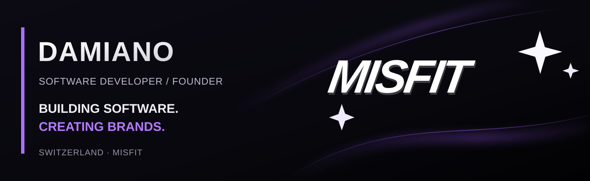

 

Building practical digital experiences with a focus on clean design, functionality and real-world impact.

---

### About

Software developer based in Switzerland, with an interest in technology, design and entrepreneurship. Currently developing software and growing **MISFIT**, an independent streetwear brand.

### Tech Stack

**Frontend**

**Backend**

**Mobile & Tools**

