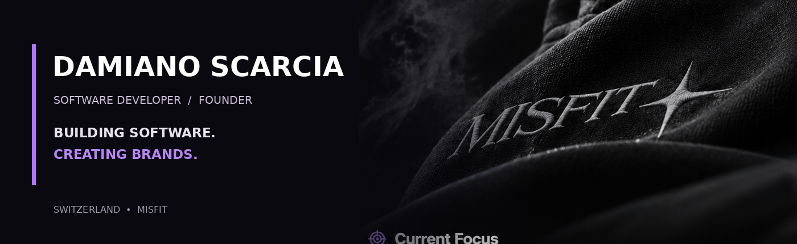

 

# Hey, I'm Damiano 👋

### Software Developer &nbsp;·&nbsp; Founder of **MISFIT**

Building digital products and an independent streetwear brand in Switzerland 🇨🇭

---

### ✦ About Me

I'm a Switzerland-based software developer interested in modern web experiences, practical applications and entrepreneurship.

Beyond coding, I'm building **MISFIT** — an independent streetwear brand centered on individuality, creativity and self-expression.

- 💻 **Development:** Modern web applications and digital experiences
- ✦ **Entrepreneurship:** Founder & Owner of **MISFIT**
- 🚀 **Current focus:** Growing MISFIT, developing products and refining my engineering skills

### ⚡ Tech Stack

**Frontend**

**Backend**

**Mobile & tools**

### 🖤 Featured Work

| Project | What I'm building | Explore |
| :--- | :--- | :--- |
| **MISFIT** | Independent streetwear brand — design, e-commerce and brand identity. | [Instagram ↗](https://www.instagram.com/misfit.ch/) |
| **Personal Portfolio** | My development experience, work and ways to connect. | [Portfolio ↗](https://damiano-scarcia.vercel.app) |

### 📫 Let's Connect

Have a project, an idea or want to follow the journey? Connect through my [portfolio](https://damiano-scarcia.vercel.app) or explore [MISFIT](https://www.instagram.com/misfit.ch/).

---

**BUILDING SOFTWARE. CREATING BRANDS. THINKING INDEPENDENTLY.**

Made with purpose in Switzerland 🇨🇭

